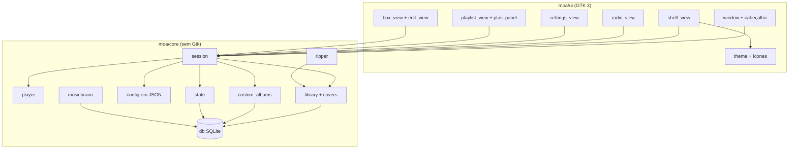
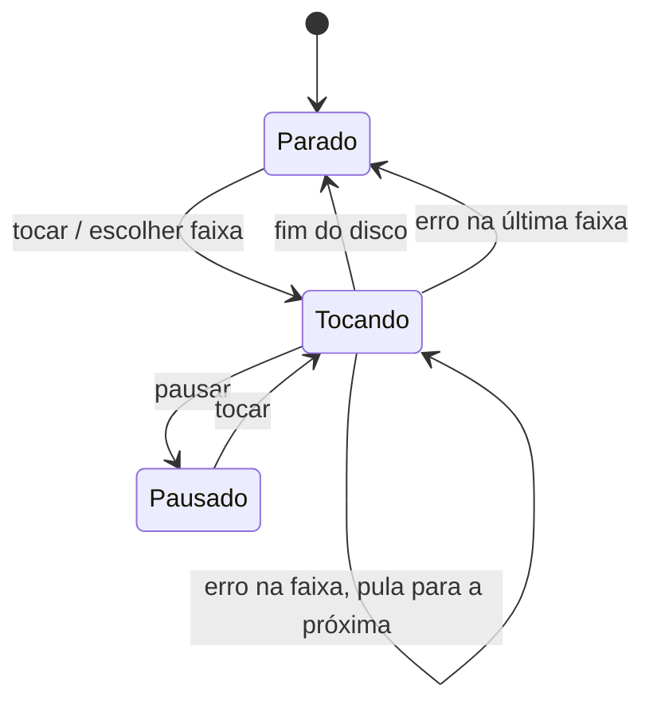

# Moa Media Player: MVP restante (M2 a M9) - Plan

## Goal Capsule

- **Objective:** um idoso que usa mouse abre o Moa Media Player no notebook dele, acha sozinho o disco que quer na estante, ouve a coleção toda offline e consegue guardar, montar e arrumar discos sem ajuda de outra pessoa e sem nunca ver uma mensagem técnica.
- **Means:** os oito marcos restantes do `CLAUDE.md` (M2 a M9), em ordem, sobre o núcleo do M1 já testado (KTD1, KTD6).
- **Authority:** o `CLAUDE.md` e os ADRs 0001 a 0009 mandam; o preview `docs/preview/moa-preview.html` é a referência visual aprovada; este plano só detalha o como. Em conflito, vale o `CLAUDE.md`.
- **Execution profile:** código em Python 3.10+, GTK 3, GStreamer, SQLite. Trabalho no ramo `mvp`, um push por marco. Não existe a CLI `gh` nesta máquina, então o fim da entrega é o ramo enviado e a URL de comparação, sem pull request e sem merge em `main`.
- **Stop conditions:** parar e relatar se uma decisão assentada (R-IDs e KTDs rotulados) se mostrar inviável, se um teste não puder passar sem quebrar uma regra do projeto, ou se uma dependência nova (fora de `python3-gi`, GTK, GStreamer, mutagen, `sqlite3`, `urllib`) parecer necessária.
- **Who finishes:** o executor implementa até o M9. O autor revisa depois, com a lista de decisões provisórias dos ADRs 0010 em diante.

---

## Product Contract

### Summary

O M2 faz o app tocar de verdade, com volume, ReplayGain, "Voz mais clara" e retomada. O M3 desenha as telas Estante, Tocando agora e Configurações como no preview aprovado. O M4 entrega montar discos, o botão "+", a Caixa e a edição de disco. O M5 blinda o app contra erro, queda de energia e segunda abertura. O M6 e o M7 acrescentam a rede opcional e a cópia de CD. O M8 empacota em `.deb`, e o M9 entrega as ferramentas de medição e de teste com usuário.

### Problem Frame

O M0 e o M1 deixaram uma janela vazia e uma biblioteca testada (leitor de pastas e tags, capas, miniaturas, banco SQLite e varredura incremental), mas nada toca nem aparece na tela. O usuário real é o pai do autor: um idoso típico sem demência, que usa mouse, num notebook antigo com HD mecânico. O projeto existe para dar autonomia a ele, reaproveitando objetos que ele já conhece (estante de discos, rádio). Cada função que exigisse outra pessoa, jargão ou precisão fina de mão contraria o motivo do projeto.

### Requirements

**Reprodução e memória**

- R1. O app toca o disco escolhido da primeira à última faixa, com tocar e pausar, anterior e próxima; no fim do disco ele para e diz "Este é o fim do disco".
- R2. O volume é do app, em 10 degraus de 0 a 100%, sem nunca passar de 100%; começa em 6 de 10; no limite o botão vira "No máximo" ou "No mínimo".
- R3. O ReplayGain é aplicado quando as tags existem; "Voz mais clara" liga e desliga um reforço de voz e agudos, começa desligada e a escolha é lembrada.
- R4. O app guarda disco, faixa e posição e abre em "Continuar a ouvir"; nada toca sem um clique.
- R5. Uma faixa que não toca é pulada com uma mensagem calma no visor ("Não consegui tocar esta música. Vou tocar a próxima."), e nenhum erro técnico chega ao idoso.

**Telas**

- R6. A Estante mostra os discos por artista e depois álbum, com a capa ou a capa substituta; um clique abre e toca; tem as seções "Continuar a ouvir", "Ouvidos há pouco", "Meus discos" e "Discos que montei", o lugar vazio "Em uso no rádio" e um mini-rádio fixo enquanto há música.
- R7. Tocando agora tem o visor que fala (estado em frase, lâmpada, palavra e cor ou forma do botão), capa grande, nome da música, disco, "Faixa X de Y", o tempo como texto ("1:23 de 3:45", não clicável), volume em degraus com "Volume: N de 10" e a lista de músicas do disco.
- R8. Toda tela tem um cabeçalho fixo: "Voltar para a estante" sempre no mesmo canto (na Estante, o título "Minha estante"), o nome da tela e o botão "Configurações".
- R9. Configurações tem o tamanho da letra (Normal, Grande, Maior) e quatro paletas (normal, vermelho e verde, azul e amarelo, preto e branco); vale para todas as telas e é lembrado; nenhuma informação depende só da cor.
- R10. Alvos clicáveis de no mínimo 64x64 px, texto de no mínimo 20 px (na escala Normal), contraste de 7:1 ou mais em todas as paletas, um clique para tudo (sem duplo clique, arrastar, hover ou botão direito), ícone sempre com texto, foco de teclado bem visível; espaço e setas funcionam como atalhos opcionais.

**Coleção e montagem**

- R11. "Criar uma playlist" cria um disco montado virtual: marcar músicas com caixas grandes, busca que recebe a digitação sem clicar nela, marcações que persistem ao filtrar, nome sugerido "Meu disco de dd/mm", capa em mosaico e "Guardar na estante".
- R12. O botão "+" de cada música abre as capas dos discos montados ("Em qual disco?", com "Disco novo" tracejado primeiro), confirma no próprio lugar com "Desfazer" e não duplica a música.
- R13. "Tirar da estante" leva o disco para a Caixa sem apagar arquivos; "Apagar de vez" só existe dentro da Caixa, com texto claro e os botões "Manter o disco" e "Sim, apagar de vez", e só apaga os arquivos daquele disco.
- R14. Editar disco permite mudar nome e capa (do arquivo, da pasta, desenhada) com prévia ao vivo, e oferece "Guardar", "Deixar como estava" e "Como era antes".
- R15. Mensagens e confirmações ficam na tela até a próxima ação do usuário; nenhuma some sozinha.

**Robustez, rede e cópia**

- R16. O app grava log em arquivo, nunca mostra diálogo técnico, abre uma instância só (abrir de novo traz a janela para a frente), impede suspensão e descanso de tela enquanto toca, salva o estado ao fechar pelo X e abre sozinho ao entrar na sessão.
- R17. O app funciona 100% offline; com internet ele pode consultar o MusicBrainz e o Cover Art Archive em segundo plano, aplica o resultado na próxima abertura, falha em silêncio, não envia telemetria e respeita 1 requisição por segundo.
- R18. Ao inserir um CD, o app o copia para a pasta de música como "Disco N" e ele entra na estante; nome e capa chegam depois, pela rede opcional. Este caminho fica marcado como não testado com leitor de CD real.

**Entrega e avaliação**

- R19. Existe um pacote `.deb` que instala sem internet, declara as dependências, cria o atalho e o ícone (uma moa original com fones) e liga a abertura automática.
- R20. Existem `tools/measure.sh` (RAM, CPU tocando, abertura a frio e a quente, tamanho instalado, em CSV) e `docs/testes-usabilidade.md` (roteiro de tarefas, planilha de tempo e erros, SUS em português).
- R21. O núcleo (`moa/core/`) não importa GTK; nenhuma dependência nova entra sem ADR com licença conferida; todo `.py` ou `.sh` novo traz o cabeçalho de licença; cada marco termina com testes passando.

### Key Decisions

Decisões de produto assentadas pelo autor. O texto normativo mora nos R-IDs governados.

- **Estante de músicas + rádio antigo como metáfora; sem cuidador nem modo escondido.** (session-settled: user-directed — chosen over interface convencional de lista e menus e modo cuidador atrás de atalho: o objetivo é a autonomia do idoso.) Governs R6, R7, R13, R14.
- **Janela normal de programa, com o X do sistema.** (session-settled: user-directed — chosen over tela cheia e botão "Desligar" próprio: o X precisa ficar visível e ser aprendido.) Governs R16.
- **Playlist é um disco novo e virtual na estante, criável pelo botão grande e pelo "+".** (session-settled: user-directed — chosen over playlist como conceito separado de disco: coerência com a metáfora.) Governs R11, R12.
- **O "+" mostra capas de discos.** (session-settled: user-approved — chosen over as duas frases "Adicionar a uma playlist existente" e "Criar uma nova playlist": menos leitura e uma decisão só.) Governs R12.
- **"Tirar da estante" manda para a Caixa; "Apagar de vez" só dentro dela.** (session-settled: user-directed — chosen over não existir apagar ou existir fora da Caixa: autonomia com segurança.) Governs R13.
- **Letra e cores para daltonismo ficam atrás do botão "Configurações".** (session-settled: user-directed — chosen over controle de letra no cabeçalho de toda tela: cabeçalho limpo.) Governs R8, R9.
- **"Voz mais clara" é um liga e desliga, começa desligada.** (session-settled: user-directed — chosen over controle "Tom" com grave e agudo e pré-ajuste feito por outra pessoa: simplicidade.) Governs R3.
- **Ordem da estante por artista e depois álbum.** (session-settled: user-directed — chosen over só por nome do álbum: é como se guardam CDs de verdade.) Governs R6.
- **Rede só como bônus opcional, atualização na próxima abertura, falha em silêncio.** (session-settled: user-directed — chosen over zero rede sempre: nomes e capas sem ajuda de ninguém.) Governs R17, R18.
- **Mensagens ficam até a próxima ação.** (session-settled: user-approved — chosen over avisos temporários de 10 segundos: a leitura varia entre pessoas.) Governs R15.
- **O usuário usa mouse; regras de 64 px, 20 px e 7:1.** (session-settled: user-directed — chosen over touchpad e gestos: o autor confirmou o dispositivo.) Governs R10.
- **GPL v3 ou posterior, titular Leonardo dos Santos Barcella, 2026.** (session-settled: user-directed — chosen over GPL somente v3: flexibilidade futura.) Governs R21.

### Success Criteria

- A coleção real do autor (cerca de 800 faixas em pastas por CD) aparece na estante, e cada disco toca de ponta a ponta, medido com a coleção sintética e, depois, com a real.
- Uma pessoa que nunca viu o app consegue, sem ajuda, tocar um disco, pausar, voltar para a estante, montar um disco com três músicas e tirar um disco da estante e devolvê-lo (roteiro do M9, a ser feito pelo autor).
- Nenhuma tela, em nenhuma paleta, tem texto abaixo de 20 px ou contraste abaixo de 7:1, conferido por teste automático.
- Segunda abertura da estante sem reabrir arquivos de áudio, com a abertura medida e registrada (meta de 1 s a quente e 3 s a frio, a validar no notebook real).

### Scope Boundaries

**Fora da identidade do produto**

- Modo cuidador, atalhos escondidos, aleatório e repetir.
- Controle de "Tom" com grave e agudo, barra de progresso clicável, arrastar, duplo clique.

**Adiado para depois**

- Vídeos e fotos (o autor pretende expandir; exige medição em notebook antigo e um ADR próprio).
- Telas de toque, outros idiomas além do português, Wayland específico.
- Cópia de CD em MP3 (a cópia usa FLAC; ver Assumptions).

#### Deferred to Follow-Up Work

- Validar as paletas de daltonismo com um simulador e com uma pessoa daltônica.
- Testar a cópia de CD com um leitor real e o `.m4a` com um arquivo real.
- Medir tudo no notebook real do pai do autor.

### Outstanding Questions (deferred, nenhuma bloqueia)

- Valores finais do reforço de "Voz mais clara": só se resolve ouvindo (ADR-0004).
- Se o botão "Configurações" é achado sozinho pelo usuário: só o teste do M9 responde.
- Especificações do notebook-alvo e se há leitor de CD.

### Sources

- `CLAUDE.md` (seções 2, 5 a 9, 11 e 12), ADRs `docs/adr/0001` a `0009`, `docs/preview/moa-preview.html`, `docs/ideation/`.
- Estado do repositório verificado nesta data: `moa/core/{models,textutil,library,covers,db}.py`, `moa/app.py`, `moa/ui/window.py` (uma janela vazia), 147 testes, nenhum workflow de CI.
- Máquina de desenvolvimento verificada: Python 3.12, GTK 3.24, `DISPLAY=:1`, sem `xvfb`, `dpkg-deb` presente, `lintian` e `fakeroot` ausentes; plugins GStreamer `playbin`, `rgvolume`, `volume`, `equalizer-3bands`, `equalizer-10bands` e `cdparanoiasrc` presentes.

---

## Planning Contract

### Key Technical Decisions

- KTD1. **O núcleo pode importar GStreamer e GLib, nunca Gtk.** O `player.py` mora em `moa/core/` e é testável sem janela, com `fakesink` no lugar da placa de som. (session-settled: user-directed — chosen over player dentro da camada de interface: o núcleo precisa ser testável sem tela.) Governs R21.
- KTD2. **Um `playbin` por vez, com a fila de faixas do disco dentro do nosso código.** O app avança de faixa ao receber o fim de fluxo e trata o fim do disco como parada. Rejeitado: usar `about-to-finish` e a reprodução sem intervalo, que não importa para música de CD e complica o tratamento de erro.
- KTD3. **Cadeia de áudio própria no `audio-filter`: `rgvolume`, depois `equalizer-3bands`, depois `volume`.** "Voz mais clara" muda só os ganhos do equalizador (zero quando desligada); o `volume` leva o degrau. O plugin existe aqui e já é dependência (ADR-0004). Valores de ganho são provisórios e ficam em constantes nomeadas.
- KTD4. **Volume em 11 posições, de 0 (mudo) a 10 (100%), com 10 lâmpadas que acendem conforme a posição; curva cúbica, teto 1.0 e padrão 6.** Cada posição acima de 0 é audível e o app nunca amplifica (ADR-0004; R2). (session-settled: user-approved — chosen over controlar o volume do sistema: evita dependência nova e distorção.)
- KTD5. **SQLite para o que é do usuário e do cache; JSON só para configurações.** Novas tabelas entram como migrações 2 a 4 em `moa/core/db.py` (reprodução e recentes; discos montados, Caixa e substituições; cache do MusicBrainz). (session-settled: user-directed — chosen over tudo em JSON: gravação segura em queda de energia, ADR-0008.) Governs R4, R11, R13, R14.
- KTD6. **Uma conexão de banco por thread.** `sqlite3` não compartilha conexão entre threads; trabalhadores em segundo plano abrem seu próprio `Database` pelo caminho do arquivo. O resultado volta para a interface por `GLib.idle_add`. O banco é aberto e migrado na thread principal antes de qualquer trabalhador começar, e `Database.open` nunca é chamado em paralelo. Gravações da interface durante a varredura, como a posição, são de melhor esforço: esperam pouco e, se não entrarem, só vão para o log.
- KTD7. **Estado da sessão fora do GTK.** `moa/core/session.py` guarda a tela atual, o disco no rádio, o aviso ativo e as ações de desfazer; as telas só desenham o que ele diz e chamam suas ações. Isso deixa a regra "aviso fica até a próxima ação" (R15) testável sem janela.
- KTD8. **Tema gerado em Python, não em CSS escrito à mão.** `moa/ui/theme.py` produz o CSS a partir de constantes (paletas e escala de letra) e o carrega num `Gtk.CssProvider`; os testes calculam o contraste das paletas com `contrast_ratio` de `moa/core/covers.py`. As quatro paletas e as cores de cada papel (botão principal, pausar, lâmpada, seleção, aviso) vêm do preview aprovado.
- KTD9. **Discos montados são um tipo próprio, `MixDisc`, e não um `Album` falso.** Guardam referências a faixas por caminho. A estante, o rádio e a busca tratam `Album` e `MixDisc` pela mesma interface (id, título, artista, faixas, ordem). Rejeitado: dar a um disco montado uma pasta fictícia, que enganaria a varredura e o "Apagar de vez".
- KTD10. **A Caixa e as edições de nome e capa são camadas sobre a biblioteca.** A varredura continua lendo as pastas; depois, `refresh_library` filtra os discos da Caixa e aplica as substituições. Assim um disco tirado não volta na abertura seguinte (risco apontado no ADR-0007) e nenhuma tag ou arquivo é reescrito.
- KTD11. **"Apagar de vez" só apaga arquivos de áudio e de capa dentro da pasta do disco, e só se ela estiver sob a pasta de música.** Nunca a pasta pai, nunca fora da raiz; a pasta é removida só se ficar vazia. O teste usa pastas temporárias, nunca a coleção real.
- KTD12. **Rede com `urllib` em thread própria, com User-Agent genérico.** O `User-Agent` leva o nome do app e a URL pública do repositório como contato, sem dados pessoais; limite de 1 requisição por segundo, tempo-limite curto e resultado guardado no banco para a próxima abertura. A detecção de rede (`Gio.NetworkMonitor`) fica na camada de interface e é injetada no núcleo como uma função `esta_online()`. (session-settled: user-directed — chosen over a biblioteca `musicbrainzngs`: sem dependência nova.) Governs R17.
- KTD13. **Instância única e suspensão pelo `Gtk.Application`.** O `application_id` já garante a instância única via D-Bus; o app usa `inhibit` com os sinalizadores de suspensão e de descanso de tela enquanto há música tocando.
- KTD14. **Pacote `.deb` montado só com `dpkg-deb`.** Sem `debhelper`, `fakeroot` ou `lintian` (ausentes). A árvore de arquivos é montada por um script em `packaging/`, e o teste conferido com `dpkg-deb -I` e `dpkg-deb -c`. O pacote instala o código em `/usr/lib/python3/dist-packages/moa`, um lançador em `/usr/bin/moa`, o atalho e o ícone. A abertura automática é criada pelo próprio app em `~/.config/autostart/br.tcc.Moa.desktop` na primeira execução (U10), como manda o `CLAUDE.md`.
- KTD15. **Verificação visual sem `xvfb`.** Como há uma sessão X real (`DISPLAY=:1`) e nenhum servidor virtual, os testes de interface usam `Gtk.OffscreenWindow` para desenhar uma tela em PNG, sem abrir janela visível; sem display, esses testes são pulados. A abertura real é conferida por `timeout 5 python3 -m moa` com saída 124.

### High-Level Technical Design

Arquitetura em camadas. As setas apontam de quem usa para quem é usado, e o núcleo não conhece a interface.



Ciclo de vida do player. Um erro em uma faixa nunca para o disco; o fim do disco para.



Abertura do app. A estante aparece com o que está no cache e se atualiza depois.

```mermaid
sequenceDiagram
  participant U as Usuário
  participant J as Janela
  participant T as Thread de varredura
  participant D as Banco SQLite
  U->>J: abre o app
  J->>D: lê configurações e onde parou
  J-->>U: mostra a estante com o cache
  J->>T: varre a pasta de música
  T->>D: lê e grava só o que mudou
  T-->>J: discos e miniaturas prontos (idle_add)
  J-->>U: estante atualizada
  Note over T,D: com internet, outra thread consulta o MusicBrainz e grava; o resultado aparece na próxima abertura
```

### System-Wide Impact

- **Banco de dados:** três migrações novas em `moa/core/db.py` (itens 2 a 4); cada uma é aditiva e nunca altera as tabelas do M1.
- **Biblioteca:** `read_track`, `Track` e a tabela `tracks` do M1 não mudam; o identificador do MusicBrainz mora em tabela própria (U11). `refresh_library` passa a filtrar a Caixa e aplicar as substituições (U7), e `refresh_covers` passa a receber as substituições de capa (U7 e U11). Os 147 testes do M1 continuam valendo.
- **Threads:** a varredura, as miniaturas e a rede rodam fora da thread da interface; qualquer atualização de tela passa por `GLib.idle_add` (KTD6).
- **Desempenho:** o gargalo esperado é ler tags e capas no HD frio; o cache do M1 já cobre a segunda abertura. A medição real só vale no notebook do pai do autor.
- **Privacidade e licença:** nenhuma telemetria; o `User-Agent` não leva dados pessoais; toda dependência nova exige ADR com licença conferida contra a GPL v3 ou posterior.

### Assumptions (apostas do planejamento, não confirmadas pelo autor; todas viram ADR provisório)

- A cópia de CD usa FLAC (sem perda, e o `flacenc` já vem no pacote base) e grava em `<pasta de música>/Disco N`.
- O degrau de volume usa a curva cúbica e começa em 6; o limite de uma consulta ao MusicBrainz só é aceito acima de uma pontuação alta, e na dúvida não muda nada.
- A estante mostra até 5 discos em "Ouvidos há pouco" e guarda os 6 últimos.
- A interface é escrita em código Python, sem arquivos de interface em XML.
- A tela de Configurações guarda as escolhas em JSON em `GLib.get_user_config_dir()/moa/`.
- A barra de progresso é só texto e o fim do disco para (decisões provisórias do `lfg`, a revisar).
- O X do sistema é aceito como está; desenhar um cabeçalho próprio com X grande fica como alternativa a avaliar.

### Risks & Dependencies

| Risco | Efeito | Mitigação |
| --- | --- | --- |
| Escopo muito grande para uma passada | Marcos tardios ficam rasos | Ordem fixa por valor; o M7 é o primeiro a cortar, depois o M6; um push por marco |
| Teste de GStreamer sem placa de som | Teste frágil ou travado | `fakesink` injetável; áudio de teste gerado pelo próprio GStreamer; tempo-limite em todo teste |
| Testes de GTK exigem display | Falham sem sessão gráfica | `Gtk.OffscreenWindow` e pulo automático sem display |
| Acesso ao banco entre threads | Erro de uso em tempo de execução | Uma conexão por thread (KTD6); teste de varredura em segundo plano |
| "Apagar de vez" apagar o que não deve | Perda de música real | KTD11; testes com pastas temporárias; nunca tocar na coleção real |
| Som, CD, `.m4a` e notebook antigo não testáveis aqui | Declarar sucesso sem prova | Cada ADR e a entrega final listam o que NÃO foi testado |
| Pacote `.deb` sem `lintian` nem instalação limpa | Pacote com defeito escondido | Inspeção com `dpkg-deb`; instalação em diretório temporário; avisar que falta teste num Mint limpo |

---

## Implementation Units

### Unit Index

| U-ID | Título | Arquivos principais | Depende de |
| --- | --- | --- | --- |
| U1 | Núcleo do player | `moa/core/player.py` | |
| U2 | Estado, recentes e configurações | `moa/core/db.py`, `state.py`, `config.py` | |
| U3 | Sessão, tema e esqueleto da janela | `moa/core/session.py`, `moa/ui/theme.py`, `moa/ui/window.py` | U2 |
| U4 | Tela Estante | `moa/ui/shelf_view.py` | U3 |
| U5 | Tela Tocando agora | `moa/ui/radio_view.py` | U1, U3 |
| U6 | Tela Configurações e ícones | `moa/ui/settings_view.py`, `moa/ui/icons/` | U3 |
| U7 | Discos montados e Caixa (dados) | `moa/core/custom_albums.py`, `models.py`, `db.py` | U2 |
| U8 | Criar playlist e botão "+" | `moa/ui/playlist_view.py`, `plus_panel.py` | U4, U5, U7 |
| U9 | Caixa e editar disco | `moa/ui/box_view.py`, `edit_view.py` | U4, U5, U7 |
| U10 | Robustez | `moa/core/logsetup.py`, `moa/app.py` | U5 |
| U11 | Rede opcional (MusicBrainz) | `moa/core/musicbrainz.py` | U4, U7 |
| U12 | Cópia de CD | `moa/core/ripper.py`, `moa/ui/rip_view.py` | U4, U11 |
| U13 | Empacotamento | `packaging/` | U10 |
| U14 | Avaliação | `tools/measure.sh`, `docs/testes-usabilidade.md` | U13 |

### Fase A: M2 Reprodução

### U1. Núcleo do player

**Goal:** tocar a fila de faixas de um disco com o GStreamer, com volume, ReplayGain e "Voz mais clara", sem importar Gtk.

**Requirements:** R1, R2, R3, R5, R21. Cita KTD1, KTD2, KTD3, KTD4.

**Dependencies:** nenhuma.

**Files:** `moa/core/player.py`, `tests/test_player.py`, `tests/conftest.py` (acrescentar a fixture `faixa_longa`, de alguns segundos, em `.wav`; a fixture de faixa curta já existe e dura cerca de 93 ms), `docs/adr/0010-reproducao-volume-e-voz-mais-clara.md`.

**Approach:**
- Uma classe `Player` recebe a fábrica do sink de áudio (padrão: o do sistema; nos testes, `fakesink`).
- Expõe tocar, pausar, próxima, anterior, ir para a faixa N, degraus de volume e o liga e desliga de "Voz mais clara".
- Notifica quem a usa por funções de retorno simples (mudou o estado, mudou a faixa, fim do disco, erro na faixa, posição e duração).
- Constrói a cadeia de KTD3; se o `rgvolume` ou o equalizador faltarem, toca sem eles e registra no log (nunca quebra).
- No erro de uma faixa, pula para a próxima; erro na última faixa para.
- Tocar no estado Parado, depois do fim do disco, recomeça o disco na faixa 1 (decisão provisória, ADR-0010).
- Os testes de pausa, posição e avanço no meio da faixa usam uma faixa longa e um sink que sincroniza com o relógio (`fakesink sync=true`); os de avanço e de fim do disco usam as faixas curtas.
- O ADR-0010 registra as decisões provisórias de volume (curva, padrão 6) e os ganhos iniciais de "Voz mais clara", marcados como "a ouvir com o usuário".

**Execution note:** implementar a máquina de estados primeiro, com teste, antes da cadeia de áudio.

**Patterns to follow:** `moa/core/library.py` (nunca levantar erro por arquivo estranho; log em vez de mensagem técnica) e `tests/conftest.py` (áudio de teste gerado pelo GStreamer).

**Test scenarios:**
- Tocar um disco de 3 faixas curtas com `fakesink` passa por Tocando, avança sozinho pelas 3 e termina em Parado, emitindo "fim do disco" uma vez.
- Pausar e tocar de novo mantêm a posição, e "próxima" na última faixa não quebra e para.
- O degrau 0 silencia, o degrau 10 é o máximo e nenhum degrau passa de ganho 1.0; os degraus são estritamente crescentes.
- Ligar "Voz mais clara" muda os ganhos do equalizador e desligar volta ao zero; o estado inicial é desligado.
- Uma faixa corrompida no meio do disco emite "erro na faixa" e a próxima toca; a última corrompida para sem exceção.
- Sem o plugin do equalizador (simulado), o player toca e registra o aviso no log.
- Anterior na primeira faixa reinicia a faixa; ir para uma faixa fora do intervalo é ignorado.
- Pausar no meio de uma faixa longa e tocar de novo mantém a posição (dentro de uma tolerância curta).
- Tocar depois do fim do disco recomeça na faixa 1.

**Verification:** `python3 -m pytest tests/test_player.py -q` passa e a suíte inteira continua verde; teste de mutação em três regras (teto de volume, fim do disco, pulo no erro) falha como esperado.

### U2. Estado, recentes e configurações

**Goal:** guardar onde o idoso parou, os discos recentes e as preferências, com gravação segura.

**Requirements:** R3, R4, R9, R21. Cita KTD5.

**Dependencies:** nenhuma.

**Files:** `moa/core/db.py` (migração 2: tabelas de reprodução e de recentes), `moa/core/state.py`, `moa/core/config.py`, `tests/test_state.py`, `tests/test_config.py`, `tests/test_db.py`.

**Approach:**
- A migração 2 acrescenta a posição de reprodução (disco, faixa, segundos) e a lista de recentes, sem alterar as tabelas do M1.
- `state.py` salva a posição de tempos em tempos (a cada poucos segundos tocando) e ao fechar; ao abrir, devolve onde parou, ou nada se o disco sumiu. A gravação periódica é de melhor esforço: espera pouco pelo banco e, se falhar (por exemplo, com a varredura gravando), só registra no log.
- `config.py` lê e grava o JSON (letra, paleta, "Voz mais clara") com arquivo temporário e troca atômica; JSON ausente ou corrompido volta aos padrões sem erro e guarda o arquivo ruim ao lado.

**Patterns to follow:** `Database.open` do M1 (corrompido é guardado ao lado, nunca apagado).

**Test scenarios:**
- Gravar a posição e reabrir devolve disco, faixa e segundos iguais.
- Se o disco guardado não existe mais, `state` devolve nada e não quebra.
- A lista de recentes mantém no máximo 6, sem repetir, com o mais novo primeiro.
- `config` com JSON corrompido devolve os padrões e preserva o arquivo ruim; um valor fora do conjunto permitido (letra "gigante") volta ao padrão.
- A gravação do JSON não deixa arquivo temporário e sobrevive a uma exceção no meio (o arquivo antigo continua inteiro).
- A migração 2 aplicada sobre um banco da versão 1 preserva as faixas e as capas guardadas.

**Verification:** testes de estado, configuração e migração passam; um banco do M1 criado antes é aberto e migrado sem perda.

### Fase B: M3 Telas principais

### U3. Sessão, tema e esqueleto da janela

**Goal:** a janela passa a ser um esqueleto navegável, com cabeçalho fixo, tema por paleta e escala de letra, e um estado de sessão testável sem GTK.

**Requirements:** R8, R9, R10, R15, R21. Cita KTD7, KTD8, KTD15.

**Dependencies:** U2.

**Files:** `moa/core/session.py`, `moa/ui/theme.py`, `moa/ui/window.py`, `moa/ui/widgets.py`, `moa/app.py`, `tests/test_session.py`, `tests/test_theme.py`, `tests/test_ui_smoke.py`, `docs/adr/0011-decisoes-provisorias-de-interface.md`.

**Approach:**
- `session.py` guarda a tela atual, a tela anterior, o aviso ativo (com o "Desfazer" opcional) e o disco no rádio; qualquer ação do usuário limpa o aviso, exceto o próprio desfazer.
- `theme.py` define as quatro paletas e as três escalas como constantes e gera o CSS; os papéis de cor (principal, pausar, lâmpada, seleção, aviso, foco) vêm do preview.
- `window.py` expõe o conteúdo (cabeçalho e `Gtk.Stack` com as telas) como um widget criado por uma função própria, dentro de um `Gtk.ScrolledWindow`; a `MainWindow` só o hospeda, e os testes o colocam num `Gtk.OffscreenWindow` (uma janela de topo não pode ser filha de outra).
- O botão de voltar da tela de Configurações diz "Voltar para onde eu estava"; é a exceção a R8 já decidida no ADR-0006.
- Espaço, setas e, para o volume, cima e baixo são tratados no nível da janela, antes dos botões, e ignorados só quando um campo de texto tem foco; ao trocar de tela, o foco vai para o botão principal dela (Pausar no rádio, o primeiro disco na estante).
- `widgets.py` guarda os blocos reutilizáveis (botão grande com texto, capa de disco, etiqueta de aviso).
- O ADR-0011 lista as decisões provisórias: tempo como texto, fim do disco para, tema claro, X do sistema.

**Patterns to follow:** `docs/preview/moa-preview.html` (hierarquia, cores, textos exatos dos botões e do cabeçalho).

**Test scenarios:**
- Navegar da Estante para o Rádio e voltar mantém a tela anterior correta; Configurações sempre volta para onde estava.
- Um aviso criado por uma ação some na próxima ação, mas sobrevive ao clique em "Desfazer" do próprio aviso.
- Para cada paleta, todo par de cores de texto e fundo gerado tem contraste de 7:1 ou mais.
- O CSS gerado em escala Normal nunca define texto abaixo de 20 px e botão abaixo de 64 px; nas escalas Grande e Maior os valores só crescem.
- O conteúdo da janela (cabeçalho e telas) desenha para um PNG com `Gtk.OffscreenWindow` sem erro, depois de girar o laço de eventos; sem display, o teste é pulado.
- O cabeçalho tem o botão "Configurações" em toda tela, menos na própria tela de Configurações.

**Verification:** testes passam; `timeout 5 python3 -m moa` termina com código 124; o PNG gerado é olhado e comparado ao preview.

### U4. Tela Estante

**Goal:** a estante mostra a coleção em seções, com capas, um clique para tocar, "Continuar a ouvir", lugar vazio e mini-rádio.

**Requirements:** R4, R6, R10. Cita KTD6, KTD7, KTD9.

**Dependencies:** U3.

**Files:** `moa/ui/shelf_view.py`, `moa/ui/loader.py` (varredura em segundo plano), `tools/make_synthetic_collection.py`, `tests/test_shelf_view.py`, `tests/test_loader.py`, `tests/test_synthetic_collection.py`.

**Approach:**
- O carregador abre sua própria conexão com o banco, executa `refresh_library` e `refresh_covers` em uma thread e devolve os discos pela fila principal; a estante já aparece com o cache e se atualiza depois.
- A estante desenha as seções do preview; "Ouvidos há pouco" usa os recentes; o disco que está no rádio vira o lugar vazio "Em uso no rádio"; "Continuar a ouvir" aparece quando há onde parou e nada toca.
- A estante tem três estados: carregando (varredura em curso e cache vazio: "Estou procurando os seus discos...", sem a frase de vazio e sem "Continuar a ouvir"), vazia (varredura concluída sem discos: frase calma) e preenchida. "Continuar a ouvir" só aparece depois que o disco guardado existe na biblioteca carregada.
- `tools/make_synthetic_collection.py` gera uma coleção sintética de cerca de 80 discos e 800 faixas (áudio curto do GStreamer, tags variadas, algumas pastas sem tags, capas embutidas, de pasta e ausentes); serve às verificações do M3, ao M9 e aos testes de desempenho.
- Cada disco é um botão de um clique; sem miniatura, usa a capa substituta de `substitute_cover`.
- O mini-rádio fixo (nome da faixa, Pausar, Abrir o rádio) aparece fora da tela do rádio quando há música.

**Patterns to follow:** o preview e `moa/core/covers.py` (`substitute_cover`, `refresh_covers`).

**Test scenarios:**
- Com 3 discos de artistas diferentes, a ordem exibida é artista e depois álbum.
- Disco sem miniatura usa a cor derivada do nome, a mesma em duas aberturas.
- Sem nada tocando e com posição guardada, aparece "Continuar a ouvir" com disco e faixa; clicar começa a tocar.
- Com um disco no rádio, o lugar dele mostra "Em uso no rádio" e some das seções de recentes.
- A varredura em segundo plano atualiza a estante sem congelar a janela e sem usar a conexão da thread principal.
- Primeira abertura, sem cache, mostra o estado de carregando (e não a frase de vazio) até a varredura terminar.
- Coleção vazia, com a varredura concluída, mostra uma frase calma, sem erro.
- O gerador cria o número pedido de discos e faixas, e a varredura do M1 os lê com os fallbacks esperados.

**Verification:** testes passam; o PNG da estante com a coleção sintética de 800 faixas é olhado.

### U5. Tela Tocando agora

**Goal:** o rádio com visor que fala, volume em degraus, "Voz mais clara" e a lista de músicas do disco.

**Requirements:** R1, R2, R3, R5, R7, R10, R15. Cita KTD2, KTD3, KTD7.

**Dependencies:** U1, U3.

**Files:** `moa/ui/radio_view.py`, `tests/test_radio_view.py`.

**Approach:**
- O visor mostra, em frase, o estado ("TOCANDO: Faixa 3 de 8", "PAUSADO. Aperte Tocar para continuar"), uma segunda linha com a última ação ("Volume mais alto (7 de 10)") e o tempo "1:23 de 3:45".
- Lâmpada, palavra e forma do botão carregam o mesmo estado; Tocar é verde e redondo, Pausar é âmbar e quadrado (cores vêm da paleta).
- O volume tem 10 lâmpadas, "Volume: N de 10" e botões que viram "No máximo" e "No mínimo" no limite, sem ficarem mudos.
- Cada música tem uma linha de 64 px e o botão "+" (a ligação com o painel vem em U8).
- Erro de faixa mostra a frase calma no visor; fim do disco mostra "Este é o fim do disco". Depois do fim do disco, Tocar recomeça o disco na faixa 1 (decisão provisória, ADR-0011). Os atalhos de teclado seguem a regra da janela descrita em U3.

**Patterns to follow:** o preview (textos e proporções do visor, lâmpadas e botões).

**Test scenarios:**
- Tocando, o visor diz "TOCANDO: Faixa N de M" e o botão principal diz "Pausar"; pausado, diz "PAUSADO..." e "Tocar".
- No volume 10, o botão de aumentar diz "No máximo", e clicar mostra "O volume já está no máximo." sem mudar o volume.
- "Voz mais clara" começa desligada, mostra "ligada" ou "desligada" em texto e a escolha é lembrada ao reabrir.
- Uma faixa corrompida mostra a frase calma no visor, e a próxima toca.
- No fim do disco o visor mostra "Este é o fim do disco" e o player para; clicar em Tocar recomeça o disco e o visor volta a "TOCANDO: Faixa 1 de N".
- Clicar em Próxima e apertar Espaço pausa e não avança de novo.
- Cada linha de música e cada botão tem no mínimo 64 px de altura na escala Normal.
- A mensagem do visor permanece até a próxima ação do usuário.

**Verification:** testes passam; o PNG do rádio é comparado ao preview nas paletas normal e preto e branco.

### U6. Tela Configurações e ícones

**Goal:** o usuário muda o tamanho da letra e a paleta sozinho, e os ícones de aparelhos antigos aparecem sempre com texto.

**Requirements:** R9, R10. Cita KTD8.

**Dependencies:** U3.

**Files:** `moa/ui/settings_view.py`, `moa/ui/icons/*.svg`, `tests/test_settings_view.py`, `tests/test_icons.py`.

**Approach:**
- A tela tem dois grupos: letra (Normal, Grande, Maior, com exemplo ao vivo) e cores (as quatro, com uma amostra de três cores cada); o item escolhido mostra "✓" e uma borda grossa.
- Cada escolha aplica na hora (novo CSS) e grava em `config`.
- Os ícones são SVGs originais e simples (tocar, pausar, anterior, próxima, volume, voltar, engrenagem, "+", caixa, disco); a licença é a do projeto, e nenhum ícone aparece sem texto ao lado.

**Test scenarios:**
- Escolher "Grande" aplica a escala nas telas abertas e sobrevive a reabrir o app.
- Escolher cada paleta troca as cores sem quebrar o contraste (reaproveita a checagem do tema).
- Todo ícone usado na interface existe como arquivo e carrega sem erro; nenhum botão tem ícone sem rótulo de texto.
- Configuração salva corrompida volta aos padrões sem mensagem técnica.

**Verification:** testes passam; olhar o PNG da tela em cada paleta.

### Fase C: M4 Coleção e montagem

### U7. Discos montados e Caixa (dados)

**Goal:** a camada de dados para discos montados, Caixa, nome e capa editados e "Como era antes", com "Apagar de vez" seguro.

**Requirements:** R11, R12, R13, R14, R21. Cita KTD5, KTD9, KTD10, KTD11.

**Dependencies:** U2.

**Files:** `moa/core/custom_albums.py`, `moa/core/models.py` (`MixDisc`), `moa/core/db.py` (migração 3), `moa/core/library.py` (filtro da Caixa e substituições), `moa/core/covers.py` (`refresh_covers` recebe as substituições de capa), `tests/test_custom_albums.py`, `tests/test_box.py`, `docs/adr/0012-discos-montados-caixa-e-apagar.md`.

**Approach:**
- A migração 3 cria as tabelas de discos montados (id, nome, capa) e de suas faixas por caminho, a Caixa (ids de discos) e as substituições de nome e capa com o valor anterior.
- `custom_albums.py` cria, renomeia, adiciona e remove faixas (sem duplicar), e desfaz a última operação.
- `refresh_library` passa a filtrar a Caixa e a aplicar as substituições, sem mudar o resultado quando não há nada guardado.
- "Apagar de vez" segue o KTD11 e, para um disco montado, só apaga o registro.
- `refresh_covers` passa a receber as substituições de capa: elas têm prioridade sobre `find_cover` e entram na assinatura do disco para invalidar o cache; a capa "desenhada" é representada por "sem fonte, usar `substitute_cover`".
- Qualquer falha ao apagar (permissão negada, arquivo somente leitura, disco indisponível) deixa o disco na Caixa com os arquivos que sobraram, registra os detalhes no log e devolve um resultado de falha parcial para a tela mostrar.

**Patterns to follow:** a migração e o `_apagar_exceto` de `moa/core/db.py`.

**Test scenarios:**
- Criar um disco montado com 3 faixas devolve as 3 na ordem escolhida e o disco aparece na biblioteca.
- Adicionar uma faixa já presente não duplica e informa que já estava.
- Desfazer remove a última faixa adicionada ou o disco recém-criado.
- Tirar um disco da estante o some da biblioteca na abertura seguinte e "colocar de volta" o traz de volta; nenhum arquivo muda.
- "Apagar de vez" remove só os arquivos de áudio e de capa daquela pasta; uma pasta vizinha e a pasta pai ficam intactas; a pasta some se ficar vazia.
- "Apagar de vez" recusa um caminho fora da raiz da música, um link simbólico para fora e uma pasta que não é um disco.
- Uma falha no meio de "Apagar de vez" (arquivo somente leitura) deixa o disco na Caixa com os arquivos restantes e devolve falha parcial; nada fora da pasta é tocado.
- Uma capa trocada pelo usuário passa a valer na abertura seguinte, e a miniatura antiga é descartada.
- Renomear e trocar a capa guardam o valor antigo, e "Como era antes" os restaura uma vez.
- Uma faixa de disco montado cujo arquivo sumiu é pulada sem erro e registrada no log.
- Com a Caixa e as substituições vazias, `refresh_library` devolve exatamente o mesmo resultado do M1.

**Verification:** testes passam; mutação nas regras de segurança do apagar (limite da raiz, pasta vizinha) falha como esperado; a coleção real nunca é tocada.

### U8. Criar playlist e botão "+"

**Goal:** as duas formas de montar um disco: a tela "Criar uma playlist" e o painel de capas do "+".

**Requirements:** R11, R12, R15. Cita KTD7, KTD9.

**Dependencies:** U4, U5, U7.

**Files:** `moa/ui/playlist_view.py`, `moa/ui/plus_panel.py`, `tests/test_playlist_view.py`, `tests/test_plus_panel.py`.

**Approach:**
- A tela lista todas as músicas com caixas de marcar de 64 px; começar a digitar manda o foco para a busca sem clicar; as marcações ficam guardadas na sessão fora do filtro; o disco novo ao lado se enche e mostra o nome sugerido e o mosaico das capas; "Mudar o nome" abre um campo de texto; o caminho só com mouse (escolher um disco e marcar) existe.
- O painel do "+" mostra "Disco novo" tracejado e as capas dos discos montados; escolher confirma na própria linha ("Está no disco X") com "Desfazer" e sem duplicar; o aviso fica até a próxima ação (KTD7).
- O nome sugerido não repete: "Meu disco de dd/mm", "Meu disco de dd/mm (2)".

**Patterns to follow:** o preview (textos "Marcada", "Escolhidas", "Guardar na estante", "Está no disco").

**Test scenarios:**
- Digitar uma letra com a tela aberta e o foco fora do campo move o foco para a busca e inclui a letra.
- Marcar 3 músicas, filtrar e limpar o filtro mantém as 3 marcadas e o contador certo.
- Guardar cria o disco, volta à estante e mostra o aviso "Pronto! O disco ... está na estante" até a próxima ação.
- O "+" em uma música já presente em um disco mostra "Já está neste disco" e não duplica.
- "Disco novo" pelo "+" cria o disco com a música e um nome sugerido sem repetição.
- "Desfazer" depois do "+" remove a música (ou o disco recém-criado); clicar em outra coisa antes faz o aviso e o desfazer sumirem.
- Cada caixa de marcar e cada capa clicável tem no mínimo 64 px.
- Uma falha ao gravar o disco montado mostra a frase calma e mantém as marcações.

**Verification:** testes passam; os PNGs das duas telas são comparados ao preview.

### U9. Caixa e editar disco

**Goal:** a Caixa (com "Apagar de vez") e a tela de editar nome e capa.

**Requirements:** R13, R14, R15. Cita KTD10, KTD11.

**Dependencies:** U4, U5, U7.

**Files:** `moa/ui/box_view.py`, `moa/ui/edit_view.py`, `tests/test_box_view.py`, `tests/test_edit_view.py`.

**Approach:**
- A Caixa lista os discos tirados, com "Colocar de volta na estante" e "Apagar de vez…"; este abre a pergunta clara com "Manter o disco" destacado e "Sim, apagar de vez"; o texto muda para disco montado ("o disco montado será desfeito").
- A tela de editar tem o campo de nome, a galeria de capas (arquivo, pasta, desenhada, com prévia ao vivo), "Guardar", "Deixar como estava" e "Tirar da estante"; depois de guardar, o aviso oferece "Como era antes".
- Qualquer falha ao apagar, guardar ou tirar mostra, no aviso da própria tela (o aviso de sessão do KTD7, que fica até a próxima ação), uma frase calma, como "Não consegui apagar tudo. O que sobrou continua na Caixa."; o disco com arquivos restantes segue listado na Caixa e os detalhes vão para o log.

**Test scenarios:**
- Tirar um disco mostra "As músicas continuam no computador" e o disco aparece na Caixa.
- "Apagar de vez" só aparece na Caixa e nunca na estante nem na tela de editar.
- Escolher "Manter o disco" fecha a pergunta sem apagar nada; "Sim, apagar de vez" apaga só aquele disco.
- Editar o nome atualiza a prévia a cada letra; "Deixar como estava" não grava nada.
- "Como era antes" restaura nome e capa; uma segunda vez não faz nada.
- Nome vazio mantém o nome atual.
- Uma falha parcial ao apagar mostra a frase calma, mantém o disco na Caixa e não perde nada do que sobrou.

**Verification:** testes passam; o PNG de cada tela é olhado; o fluxo de apagar roda só com arquivos de teste.

### Fase D: M5 Robustez

### U10. Robustez

**Goal:** log em arquivo, erros calmos, instância única, suspensão inibida e estado salvo ao fechar.

**Requirements:** R5, R16. Cita KTD13.

**Dependencies:** U5.

**Files:** `moa/core/logsetup.py`, `moa/core/autostart.py`, `moa/app.py`, `moa/ui/window.py`, `tests/test_logsetup.py`, `tests/test_autostart.py`, `tests/test_single_instance.py`.

**Approach:**
- O log vai para `GLib.get_user_data_dir()/moa/` com rotação de tamanho; nada técnico aparece na tela.
- Uma função de exceção global registra e mostra a frase calma no visor; os pontos de entrada de cada ação protegem a interface contra exceções.
- `inhibit` liga quando começa a tocar e desliga quando para ou pausa; o fechamento pelo X salva a posição e o estado e encerra.
- Na primeira execução o app cria `~/.config/autostart/br.tcc.Moa.desktop` (abertura automática ligada por padrão, como manda o `CLAUDE.md`) e guarda que já o fez; se o usuário apagar o arquivo, o app não o recria.
- A segunda abertura traz a janela existente para a frente (já garantido pelo `application_id`; o teste confirma).

**Test scenarios:**
- Uma exceção em uma ação da interface é registrada no log e o app continua aberto.
- O log não cresce sem limite (rotação) e é criado se a pasta não existe.
- Iniciar um segundo processo com o mesmo `application_id` não abre uma segunda janela e traz a primeira para a frente.
- Fechar pelo X grava disco, faixa e posição; reabrir mostra "Continuar a ouvir".
- Na primeira execução o arquivo de abertura automática é criado com o `Exec` correto; uma segunda execução não o recria depois de apagado.
- A inibição é pedida ao tocar e liberada ao parar.

**Verification:** testes passam; abrir e fechar o app real com `timeout`; conferir o log gerado.

### Fase E: M6 Rede opcional

### U11. Rede opcional (MusicBrainz)

**Goal:** completar nomes e capas pelo MusicBrainz, em segundo plano, sem nunca depender da rede.

**Requirements:** R17, R21. Cita KTD12.

**Dependencies:** U4, U7.

**Files:** `moa/core/musicbrainz.py`, `moa/core/db.py` (migração 4: identificadores por disco e cache das respostas), `moa/core/covers.py` (capas baixadas e substituições entram em `refresh_covers`), `moa/ui/loader.py`, `tests/test_musicbrainz.py`, `docs/adr/0013-musicbrainz-detalhes.md`.

**Approach:**
- O identificador de álbum do MusicBrainz (`musicbrainz_albumid`) é lido por uma leitura de tags separada, só dos discos que ainda não o têm no banco, e guardado numa tabela própria da migração 4, por pasta do disco. `read_track`, `Track` e a tabela `tracks` do M1 não mudam, e as faixas já em cache não precisam ser relidas.
- Para discos copiados pelo app (U12), a consulta usa o identificador do disco (DiscID) guardado na mesma tabela; sem ele e sem identificador de álbum, nada muda.
- Com identificador, a consulta é exata; sem ele, só aceita uma correspondência de alta confiança e, na dúvida, não muda nada.
- O limitador garante 1 requisição por segundo; erros, tempo esgotado e respostas estranhas viram log e nada mais.
- O resultado vai para a tabela da migração 4 e só é aplicado na próxima abertura; capas baixadas do Cover Art Archive entram como fonte de capa e passam pelo gerador de miniaturas.
- `esta_online()` é uma função injetada pela interface (`Gio.NetworkMonitor`); o núcleo não a conhece.

**Test scenarios:**
- Com um servidor HTTP local falso, uma consulta por identificador guarda nome e capa e a abertura seguinte os usa.
- Sem identificador e com resultado ambíguo, nada muda.
- Servidor fora do ar, tempo esgotado, JSON inválido e resposta 503 não geram exceção nem mensagem; o app segue igual.
- Sem rede (`esta_online()` falso) nenhuma conexão é tentada.
- Um disco já em cache de faixas recebe o identificador na primeira consulta, sem reler as demais faixas.
- Um disco copiado, sem tags de álbum, mas com DiscID guardado, recebe nome e capa do servidor falso na abertura seguinte.
- Duas consultas seguidas respeitam o intervalo de 1 segundo.
- O `User-Agent` enviado não contém e-mail nem dados da máquina.

**Verification:** testes passam; conferir que o app inteiro funciona com a rede desligada.

### Fase F: M7 Cópia de CD

### U12. Cópia de CD

**Goal:** copiar um CD para a pasta de música e colocá-lo na estante.

**Requirements:** R18. Cita KTD1.

**Dependencies:** U4, U11.

**Files:** `moa/core/ripper.py`, `moa/ui/rip_view.py`, `tests/test_ripper.py`, `docs/adr/0014-copia-de-cd.md`.

**Approach:**
- A cadeia `cdparanoiasrc`, depois conversão, depois `flacenc`, depois arquivo, grava `Disco N/Faixa NN.flac`, com a trilha numerada pelo número da faixa do CD.
- A fonte é injetável, então o teste usa um `audiotestsrc` no lugar do leitor.
- O identificador do disco (DiscID do MusicBrainz), quando o GStreamer o informa como tag da fonte, é guardado na tabela da migração 4 (U11), junto da pasta criada, para a consulta posterior. Isso não pôde ser conferido com um leitor real.
- A interface (`rip_view`) mostra "Copiando o disco... faixa 3 de 12" e, ao fim, o disco novo na estante; a detecção do CD usa `Gio.VolumeMonitor`.
- O ADR-0014 diz, em letras claras, que este marco NÃO foi testado com um leitor de CD real.

**Execution note:** é um marco condicional; se `cdparanoiasrc` ou `flacenc` faltarem no destino, o app não mostra nada ao idoso e registra o motivo.

**Test scenarios:**
- Com fonte falsa de 3 faixas, o resultado são 3 arquivos `.flac` numerados em `Disco N`, e a varredura os encontra como um disco.
- O número do disco não repete um já existente.
- Falha no meio (disco riscado simulado) para sem deixar arquivo pela metade e sem mensagem técnica.
- Sem o plugin necessário, a função devolve "indisponível" e nada quebra.

**Verification:** testes com fonte falsa passam; o relatório final lista este marco como não testado com hardware.

### Fase G: M8 Empacotamento

### U13. Empacotamento

**Goal:** um `.deb` que instala offline, com atalho, ícone e abertura automática.

**Requirements:** R16, R19. Cita KTD14.

**Dependencies:** U10.

**Files:** `packaging/build-deb.sh`, `packaging/DEBIAN/control.in`, `packaging/br.tcc.Moa.desktop`, `packaging/moa` (lançador), `moa/__main__.py` (trata `--version`), `packaging/icons/moa.svg`, `tests/test_packaging.py`, `docs/adr/0015-empacotamento-deb.md`.

**Approach:**
- O script monta a árvore de arquivos e roda `dpkg-deb --build`; a versão vem de um único lugar (`moa/__init__.py`).
- O `control` declara `python3`, `python3-gi`, `gir1.2-gtk-3.0`, `gir1.2-gstreamer-1.0`, `gstreamer1.0-plugins-base`, `gstreamer1.0-plugins-good` e `python3-mutagen`.
- `moa/__main__.py` trata `--version` (imprime a versão e sai com 0) antes de importar `moa.app`, o que dispensa display e permite testar o lançador extraído.
- O ícone é uma moa original com fones, em SVG, de autoria própria sob a licença do projeto.
- O ADR-0015 registra o que não foi possível validar (instalação em um Mint limpo, `lintian`).

**Test scenarios:**
- O pacote é construído em uma pasta temporária e `dpkg-deb -I` mostra o nome, a versão e as dependências corretas.
- `dpkg-deb -c` lista o código, o lançador, o atalho e o ícone.
- Os arquivos `.desktop` têm as chaves exigidas, e o `Exec` aponta para o lançador existente.
- O pacote contém o `LICENSE` e o aviso de direitos autorais.
- A extração do pacote em uma pasta temporária e a execução do lançador com `python3 -m moa --version` (ou equivalente) funcionam.

**Verification:** testes passam; o `.deb` gerado é inspecionado; o relatório diz que a instalação num sistema limpo não foi testada.

### Fase H: M9 Avaliação

### U14. Avaliação

**Goal:** medir o app de forma repetível e entregar o roteiro de teste com usuário.

**Requirements:** R20. Cita KTD15.

**Dependencies:** U13.

**Files:** `tools/measure.sh`, `docs/testes-usabilidade.md`, `docs/medicoes/` (resultados), `tests/test_measure.py`.

**Approach:**
- `measure.sh` mede a RAM (RSS), a CPU média tocando, o tempo até a estante aparecer (a frio e a quente), o tamanho instalado, e acrescenta uma linha com data e configuração da máquina a um CSV. Sem outra pasta indicada, usa a coleção de `tools/make_synthetic_collection.py`.
- O teste com usuário traz as tarefas ("toque o disco X", "pause", "volte para a estante", "monte um disco com estas músicas", "tire um disco da estante e devolva-o"), a planilha de tempo e erros, o questionário SUS em português e as notas de ética (consultar o orientador sobre o termo de consentimento).
- Registra as primeiras medições desta máquina, com a ressalva explícita de que não valem para o notebook real.

**Test scenarios:**
- O script roda sem erro com o app aberto por `timeout` e escreve uma linha de CSV com todas as colunas.
- O CSV não perde as linhas antigas ao acrescentar uma nova.
- O roteiro cita cada tarefa do `CLAUDE.md` seção 12 e o SUS tem as 10 afirmações.

**Verification:** testes passam; as medições estão em `docs/medicoes/` com a data e a máquina; o relatório final repete o que não foi medido.

---

## Verification Contract

| Quando | Comando ou ação | Prova |
| --- | --- | --- |
| Antes de cada commit | `python3 -m pytest -q` | Suíte inteira verde (hoje 147 testes) |
| Em cada unidade com regra delicada | teste de mutação à mão (quebrar a regra, ver o teste falhar, restaurar) | Os testes detectam a quebra |
| Em cada unidade de interface | desenhar a tela em PNG com `Gtk.OffscreenWindow` e olhar | A tela bate com o preview aprovado |
| Fim de cada marco | `timeout 5 python3 -m moa; echo $?` sem pipe | Saída 124 (a janela abriu e ficou rodando) |
| Fim de cada marco | `git push -u origin mvp` | Ramo remoto igual ao local |
| M8 | `dpkg-deb -I` e `dpkg-deb -c` no `.deb` gerado | Dependências e arquivos corretos |
| M9 | `tools/measure.sh` | Linha nova no CSV de medições |
| Sempre | `tests/test_license_headers.py` (dentro do `pytest`) | Todo arquivo novo traz o cabeçalho |

Não existe CI neste repositório; a garantia é local. O que não pode ser verificado aqui (som real, leitor de CD, `.m4a`, notebook antigo, instalação em Mint limpo, paletas com daltônicos) deve aparecer como "não testado" nos ADRs e no relatório final.

## Definition of Done

**Global**

- Os marcos M2 a M9 têm seus requisitos atendidos, ou a parte que falta está dita por escrito (principalmente M6 e M7).
- `python3 -m pytest -q` passa, com os 147 testes de partida e os novos.
- O app abre (`timeout 5 python3 -m moa` termina em 124) e cada tela foi desenhada e olhada.
- Cada marco tem uma entrada em `docs/registro-ia.md` e cada decisão provisória está em um ADR a partir do 0010.
- Nenhum arquivo, tentativa abandonada ou código experimental sobra no diff.
- O ramo `mvp` está enviado, sem merge em `main` e sem push forçado; a URL de comparação é informada.

**Por unidade:** testes da unidade passando, cabeçalho de licença nos arquivos novos, regras do projeto cumpridas (64 px, 20 px, 7:1, um clique, sem mensagem técnica) e o que não foi testado, listado.

## Appendix

### Estrutura de arquivos prevista (novos)

```text
moa/core/player.py        state.py     config.py     session.py
moa/core/custom_albums.py logsetup.py  autostart.py  musicbrainz.py ripper.py
moa/ui/theme.py  widgets.py  loader.py  shelf_view.py  radio_view.py
moa/ui/settings_view.py  playlist_view.py  plus_panel.py  box_view.py
moa/ui/edit_view.py  rip_view.py  icons/*.svg
packaging/build-deb.sh  DEBIAN/control.in  br.tcc.Moa.desktop
packaging/moa  icons/moa.svg
tools/measure.sh  make_synthetic_collection.py
docs/testes-usabilidade.md  docs/medicoes/  docs/adr/0010 ... 0015
```
