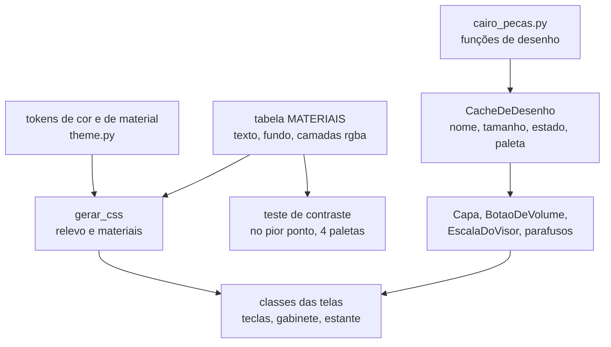
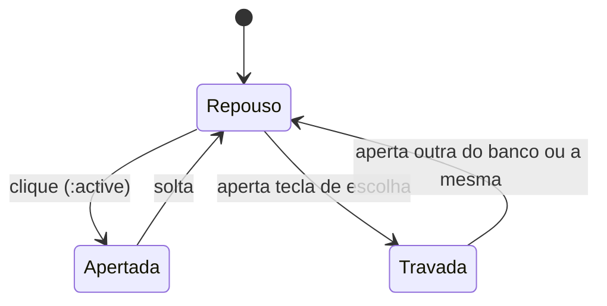

# Aparência analógica, nível 3, do Moa - Plan

**Target repo:** moa-media-player (Python 3 e GTK 3, `moa/ui/`).

## Goal Capsule

- **Objective:** O idoso vê e aperta objetos que parecem um rádio e uma estante de discos de verdade, e continua lendo cada texto e sendo atendido sem demora no notebook antigo dele.
- **Means:** Tokens de material no tema e relevo em CSS (KTD1, KTD5), mais peças desenhadas em Cairo com o desenho guardado em cache (KTD6).
- **Authority:** Product Contract (R1 a R14) > KTDs > unidades. O preview aprovado `docs/preview/aparencia-analogica.html` (nível 3) é a referência visual; em caso de conflito entre o preview e as restrições de acessibilidade (R11), vale R11.
- **Stop conditions:** parar e relatar se uma decisão firmada (Key Decisions e KTD1 a KTD4) se mostrar inviável no GTK 3; parar se algum par de texto e fundo não puder chegar a 7:1 no pior ponto sem mudar o desenho aprovado.
- **Execution profile:** código com verificação por teste, por imagem e por medição; o autor decide UX, então qualquer escolha de aparência fora do preview volta a ele.
- **Who finishes and ships:** `ce-work` implementa; o PR segue o fluxo do projeto (branch a partir da `dev`, PR para a `dev`).

---

## Product Contract

### Summary

Trocar a aparência chapada do app pelo nível 3 do preview: teclas com curso, gabinete de madeira com latão, visor de vidro, botão de volume desenhado, capa em caixa de CD e estante com profundidade. Tudo sai do tema (tokens e CSS) e de poucas peças em Cairo, nas quatro paletas, sem arquivo de imagem e sem dependência nova. O interruptor "Simples ou Aparelho" não entra.

### Problem Frame

Hoje os botões e painéis são retângulos de borda grossa (`background-image: none; box-shadow: none` em `moa/ui/theme.py`), e o autor quer que pareçam aparelhos antigos de verdade, em linha com a metáfora de estante, rádio e aparelho de CD. A ideação de 28/11 e o preview em HTML mostraram o desenho; faltam o código e a prova de que ele cabe nas regras do projeto: texto com contraste de 7:1 em todos os pontos do degradê, leveza em um Pentium T4300 com HDD e nada que dependa de arrastar.

Duas armadilhas já apareceram no preview e no GTK. Um degradê opaco esconde a cor do botão (o "Tocar" verde virou creme com letra branca), e o brilho sobre o verde derruba o contraste para 4,3:1. O plano as trata como regras.

### Requirements

**Teclas e estados**

- R1. Todo botão de ação é uma tecla de aparelho: face com brilho translúcido só na faixa de cima, sombra rígida que dá a altura, e desce ao ser apertada sem mudar a altura do botão.
- R2. As escolhas de liga e desliga ficam travadas: "Voz mais clara", o banco de teclas de tamanho da letra e de cores em Configurações (apertar uma solta as outras) e a marcação de músicas na playlist. Cada uma mostra posição baixada, lâmpada acesa e texto. "Tocar" e "Pausar" continuam trocando de botão.
- R3. As lâmpadas-piloto têm lente (brilho e aro), no estado do rádio e nas teclas travadas.

**Rádio**

- R4. O gabinete do rádio é de madeira com veios, moldura de latão, parafusos, plaquinha "MOA" e uma grade de tecido de alto-falante decorativa, sem texto e sem foco.
- R5. O visor é de vidro (degradê âmbar, sombra interna, moldura de latão, reflexo só nas bordas) e traz uma escala gravada "Faixa X de Y" com um marcador na faixa atual.
- R6. Anterior, Tocar e Próxima ficam numa moldura de metal escovado; "Tocar" é maior e redondo.
- R7. O volume é um botão desenhado (serrilha, escala gravada de 0 a 10, coroa de 10 lâmpadas com lente) que gira sozinho com "Mais baixo" e "Mais alto". Os dois botões, o texto "Volume: N de 10" e os rótulos "No mínimo" e "No máximo" continuam.

**Estante e discos**

- R8. A capa é uma caixa de CD (moldura de plástico, lombada com dobradiças, reflexo só na moldura), em todas as telas que mostram capa. O reflexo nunca cobre a arte nem o texto da capa substituta.
- R9. A estante tem fundo recuado, tampo com quina chanfrada e sombra, vão côncavo para "Em uso no rádio" e plaquinhas de latão com parafusos nos títulos de seção.
- R10. As outras telas (Aparelho de CD, Lixeira, Configurações, Criar uma playlist e o painel do "+") usam a mesma linguagem: uma direção de luz e a mesma altura de tecla, herdadas dos tokens e das classes compartilhadas.

**Restrições**

- R11. Acessibilidade: contraste de texto de pelo menos 7:1 em todos os pontos do degradê de cada material, nas quatro paletas; alvos de 64×64 px; letra de pelo menos 20 px; foco de teclado visível; ícones com texto; nada depende de arrastar, duplo clique ou passar o mouse.
- R12. As quatro paletas herdam o relevo por tokens. O preto e branco usa contorno duplo e sombra, sem tons.
- R13. Leveza: nenhum arquivo de imagem e nenhuma dependência nova além do que o app já usa; peças em Cairo guardadas em cache por tamanho, estado e paleta; sem animação contínua; tempos de ação e de desenho sem piora relevante na medição.
- R14. Registro: ADR-0024, entrada em `docs/registro-ia.md`, e a ideação e o preview de 28/11 entram no mesmo PR.

### Key Decisions

- **Ir direto ao nível 3.** (session-settled: user-directed — chosen over fazer o nível 2 isolado e subir só as peças de maior ganho: o autor quer o visual detalhado completo.) Governs R1 a R10.
- **"Tocar" e "Pausar" continuam trocando de botão.** (session-settled: user-directed — chosen over um PLAY que fica baixado como num gravador de fita: trocar o texto é mais claro para o idoso.) Governs R2.
- **O botão de volume não é arrastável nem clicável.** (session-settled: user-approved — chosen over um botão arrastável ou clicável: regra do `CLAUDE.md` contra arrastar e risco de o usuário tentar arrastar.) Governs R7.

### Success Criteria

- Nas quatro paletas e nas três escalas de letra, as seis telas (Estante, Tocando agora, Aparelho de CD, Lixeira, Configurações e Criar uma playlist) renderizam sem erro de CSS e batem com o nível 3 do preview.
- `bash tools/measure.sh --rapido --sem-audio` depois da mudança não mostra piora relevante nas ações e na abertura em relação à medição de antes (a base é a de hoje, no `mix` de 371 faixas e na `estante` de 80 discos).
- Um leitor da banca consegue defender o código: cada peça desenhada tem uma função de desenho pequena e nomeada, e o tema continua sendo gerado a partir de tokens.

### Scope Boundaries

**Outside this plan's decisions (decisões do autor, ainda abertas)**

- O interruptor "Simples ou Aparelho" (ideia I7).
- Clicar no próprio botão de volume.
- A barra de progresso da música.
- Cor da lombada da capa: cinza-escuro por padrão, sem variar por disco.
- Cor da sombra rígida: preta por padrão.

**Outside this product's identity**

- Animação contínua, som de clique, arquivo de imagem como textura, lombada de disco em pé com texto vertical.

#### Deferred to Follow-Up Work

- Medição no notebook do usuário (Pentium, HDD) depois do merge: o plano mede só na máquina de desenvolvimento.
- Troca de ícones dos botões por versões de aparelho: os ícones SVG atuais ficam.

---

## Planning Contract

### Context and Research

- `moa/ui/theme.py` gera o CSS a partir de tokens (`_NORMAL`, `PALETAS`) e já testa 7:1 por pares de tokens (`PARES_DE_CONTRASTE`). Os testes de `tests/test_theme.py` leem o CSS por regex: `font-size` mínimo de 20 px e `button.moa-\w+ { ... min-height: N px }` com N de pelo menos 64. O CSS novo precisa manter esses formatos.
- `moa/ui/radio_view.py` monta o painel do rádio uma vez e atualiza no lugar (`_construir_painel`, `_atualizar_painel`, `_montar_controles`); os testes de `tests/test_radio_lista.py` conferem `p.barras`, `p.clara` e `p.lampada`.
- `moa/ui/widgets.py` tem `Capa`, uma `Gtk.DrawingArea` que desenha a miniatura ou a capa substituta com `cr` (Cairo), e `capa_do_disco`. `Capa` é usada na estante, no visor, no painel do "+", na edição, na Lixeira e no cartão da playlist.
- O app já depende de `python3-gi-cairo` (a `Capa` recebe `cr` do GTK), que traz `python3-cairo`, mas `tools/build_deb.sh` (linha `Depends:`) e `tools/check_deps.sh` não o declaram.
- Sonda feita no GTK 3 desta máquina (descartável): brilho `rgba` por cima de `background-color` preserva a cor do token e deixa a letra legível; trocar `border-bottom-width: 9px` por `4px` com `padding-top` maior faz a tecla descer e deixa as cinco teclas da amostra com a mesma altura (92 px).
- Segunda sonda no GTK 3: anéis de latão por `box-shadow` com raio de espalhamento (`0 0 0 3px` e `0 0 0 5px`), veios por `repeating-linear-gradient` com `rgba` e visor com reflexo e sombra interna desenham como no preview.
- Medição de custo de relevo em CSS (ideação de 28/11): 11,3 a 11,7 ms por desenho da tela do rádio, contra 11,5 ms do chapado, na máquina de desenvolvimento.
- Não há `STRATEGY.md`, `CONCEPTS.md` nem `docs/solutions/`. Pesquisa externa não foi necessária: é CSS e Cairo locais, sem tecnologia nova.

### Key Technical Decisions

- KTD1. **Relevo é sempre camada translúcida e sombra rígida sobre a cor do token, nunca um degradê opaco em `background-image`.** (session-settled: user-approved — chosen over degradê opaco: ele esconde a cor do botão, e o "Tocar" verde virou creme com letra branca.) Cita R1, R11.
- KTD2. **O brilho do botão verde fica só na faixa de cima, nunca atrás da letra; o latão que leva texto usa o tom claro (#E8CF8A a #D6B25C) e o escuro (#B8902E) só aparece em molduras sem texto.** (session-settled: user-approved — chosen over brilho cobrindo a letra e latão escuro com texto: o contraste cai para 4,3:1 e 5,9:1, abaixo de 7:1.) Cita R1, R4, R9, R11.
- KTD3. **No preto e branco o relevo é contorno duplo e sombra, sem tons.** (session-settled: user-approved — chosen over relevo por tons também no preto e branco: essa paleta existe para o contraste máximo.) Cita R12.
- KTD4. **Sem arquivo de imagem e sem dependência nova: arte original em CSS e Cairo, com o desenho em cache e sem animação contínua.** (session-settled: user-approved — chosen over PNG com `border-image` e animação: custo, licença GPL e CPU antiga.) Cita R13.
- KTD5. **A tecla desce trocando a borda de baixo por espaço em cima, porque o GTK 3 não tem `transform`.** Em repouso: `border-bottom-width: 9px`. Apertada ou travada: `border-bottom-width: 4px` e `padding-top` maior pela mesma diferença. A altura total não muda, então nada ao redor se mexe. Cita R1, R2. Evidência: a sonda no GTK 3 (Context and Research).
- KTD6. **As peças em Cairo ficam em `moa/ui/cairo_pecas.py` como funções de desenho puras, e um `CacheDeDesenho` guarda a superfície pronta, com chave de nome, tamanho, estado e paleta.** Os widgets (`Capa`, `BotaoDeVolume`, `EscalaDoVisor`) só pintam a superfície guardada. Cita R7, R8, R13.
- KTD7. **Parafusos e dobradiças saem de um `connect_after("draw")` em contêineres que já existem, porque o CSS do GTK 3 não tem `::before` nem `::after`.** A função de desenho vem de `cairo_pecas.py` e usa o cache. Cita R4, R9, R13.
- KTD8. **Uma tabela única de materiais (`MATERIAIS`, em `theme.py`) alimenta o gerador de CSS (as opacidades) e o teste de contraste no pior ponto.** Assim o número que o teste confere é o mesmo que vai para o CSS. Cita R11.
- KTD9. **A escala do visor desenha no máximo cerca de 24 marcas e agrega as faixas quando o disco é grande** (o disco do usuário tem 371 faixas), com o marcador proporcional e só "1" e o total como números. Cita R5.
- KTD10. **`python3-gi-cairo` passa a ser declarado em `tools/build_deb.sh` e `tools/check_deps.sh`, já que o app depende dele hoje sem dizer.** Sem isso uma instalação limpa do `.deb` pode falhar ao desenhar a capa. Cita R13.
- KTD11. **A medição de antes é feita na primeira unidade, antes de qualquer mudança, e a de depois na última, com o mesmo comando e as mesmas coleções.** Cita R13.
- KTD12. **As peças em Cairo leem a paleta atual na hora de desenhar, e o tema a expõe (`paleta_atual()`, preenchida por `aplicar`).** A paleta entra na chave do cache (KTD6). Quando o CSS é recarregado, o GTK repinta os widgets, e eles pegam a paleta nova sem que a estante seja refeita. Sem isso, as capas e os parafusos ficariam na cor da paleta antiga depois de uma troca em Configurações. Cita R8, R12.
- KTD13. **Todo texto novo, em CSS ou desenhado em Cairo (plaquinha "MOA", numerais da escala do visor, "0" e "10" do botão de volume), tem pelo menos 20 px e contraste de 7:1, ou não existe.** O preview usava numerais menores; no app eles sobem para 20 px ou saem, já que o texto de "Faixa X de Y" e de "Volume: N de 10" já diz o mesmo. Cita R11.

### High-Level Technical Design

Como as peças se ligam. Os tokens e a tabela de materiais alimentam o CSS e o teste; as funções de desenho e o cache alimentam as peças em Cairo e os parafusos; as telas só usam classes e widgets.

A tecla apertada, em estados (todos com a mesma altura total):

### Assumptions

Apostas inferidas, ainda não confirmadas pelo autor:

- As telas Aparelho de CD, Lixeira, Configurações e Criar uma playlist não ganham desenho próprio: herdam o relevo pelas classes compartilhadas (R10), com ajustes pontuais de classe.
- A grade do alto-falante fica no fim do gabinete, como peça decorativa escondida de leitores de tela.
- A moldura de latão cobre o gabinete e o visor; a de metal escovado cobre só a fileira Anterior, Tocar e Próxima.
- A escala "Faixa X de Y" aparece só no visor do rádio.
- Os botões "Colocar em outro disco" das linhas da lista de músicas usam o mesmo relevo das outras teclas; a medição do disco de 371 faixas (U8) confirma se isso pesa.

### Implementation Sequencing

U1 e U4 não dependem de nada e abrem a obra. U2 depende de U1. U3 depende de U1, U2 e U4 (liga os parafusos). U5 depende de U3 e U4, e U6 de U4. U7 reúne as telas restantes e depende de U2, U3 e U6. U8 fecha com a prova e os registros.

---

## Implementation Units

### U1. Tokens de material, tabela de materiais e contraste no pior ponto

**Goal:** Dar ao tema os tokens de madeira, latão, metal, tecla e vidro nas quatro paletas, e uma checagem de contraste que olha o pior ponto de cada material.

**Requirements:** R11, R12, R13.

**Dependencies:** nenhuma.

**Files:**
- `moa/ui/theme.py`
- `tests/test_theme.py`

**Approach:**
- Acrescentar a `_NORMAL` os tokens `wood_hi`, `wood_lo`, `brass_hi`, `brass`, `brass_lo`, `metal_hi`, `metal_lo`, `key_hi`, `key_lo`, `visor_hi`, `visor_lo`, com os valores do preview, e sobrescrevê-los nas outras paletas (preto e branco: tudo colapsa em preto ou branco).
- Criar `MATERIAIS`: cada entrada diz o texto, o fundo base e as camadas translúcidas `(cor, opacidade)` que cobrem a zona onde o texto fica. Cita KTD8.
- Criar `contraste_no_pior_ponto(paleta, material)`, que mistura as camadas sobre o fundo e devolve o menor contraste entre os pontos do degradê.
- Registrar `RELEVO_POR_PALETA` (`"tons"` por padrão, `"contorno"` no preto e branco), para o gerador de CSS escolher a forma (KTD3).

**Execution note:** Antes de mudar qualquer coisa, rodar `bash tools/measure.sh --rapido --sem-audio` e guardar o resumo como a medição de antes (KTD11).

**Patterns to follow:** `PARES_DE_CONTRASTE` e `contraste()` em `moa/ui/theme.py`; a forma dos testes parametrizados por paleta em `tests/test_theme.py`.

**Test scenarios:**
- Cada material de `MATERIAIS` passa de 7:1 no pior ponto nas quatro paletas.
- O "Tocar" com o brilho só na faixa de cima passa; a armadilha (o brilho cobrindo a letra) falha, e o teste prova que a checagem enxerga o problema.
- Latão claro e médio com letra de tinta passam; o latão escuro com letra de tinta falha (prova do guarda-corpo).
- Os tokens novos existem nas quatro paletas e no preto e branco não há tom intermediário nos tokens de material.
- `RELEVO_POR_PALETA` devolve `"contorno"` só para o preto e branco.

**Verification:** o teste de contraste do pior ponto passa nas quatro paletas e falha de propósito no caso da armadilha; os testes antigos de `test_theme.py` continuam passando.

### U2. Teclas com curso, teclas travadas e lâmpadas com lente

**Goal:** Dar relevo e curso a todos os botões de ação, criar a tecla travável com lâmpada e aplicá-la onde há escolha.

**Requirements:** R1, R2, R3, R11, R12.

**Dependencies:** U1.

**Files:**
- `moa/ui/theme.py`
- `moa/ui/widgets.py`
- `moa/ui/radio_view.py`
- `moa/ui/settings_view.py`
- `moa/ui/playlist_view.py`
- `tests/test_theme.py`
- `tests/test_radio_lista.py`
- `tests/test_settings_view.py`
- `tests/test_playlist_lista.py`

**Approach:**
- No CSS, trocar o botão chapado por tecla: face em `background-color` do token com brilho `rgba` só na faixa de cima, `box-shadow` interno de realce, borda de baixo grossa que é a altura (KTD1, KTD5).
- Ler as opacidades do brilho e do realce da tabela `MATERIAIS` (KTD8), sem repetir os números no gerador de CSS.
- Dar ao brilho uma altura em pixels, menor ou igual a borda de cima mais o `padding-top`, e não em porcentagem da tecla: assim ele termina acima da letra também na escala "Maior", e o teste de U1 vale para as três escalas (KTD2).
- Escrever o estado apertado e o travado (`:active` e `.moa-travada`) como troca de borda por espaço em cima (KTD5); manter `min-height` e `font-size` nos formatos que os testes leem.
- Fazer o "Tocar" redondo e maior, e o "Pausar" âmbar, com a mesma regra (KTD2).
- Criar em `widgets.py` uma tecla travável (texto, lâmpada e estado), com função para mudar o estado no lugar, como `definir_texto_do_botao` já faz.
- Usar a tecla travável em "Voz mais clara" (`radio_view.py`), no banco de teclas de letra e de cores (`settings_view.py`, onde apertar uma solta as outras) e na marcação de músicas (`playlist_view.py`, mantendo a caixinha e o texto "Marcada").
- Dar lente às lâmpadas (`.moa-lampada`): brilho radial, aro e brilho de luz acesa.
- No preto e branco, gerar o relevo por contorno duplo e sombra (KTD3).

**Patterns to follow:** `botao()`, `definir_texto_do_botao()` e `classe()` em `moa/ui/widgets.py`; a atualização no lugar de `_atualizar_painel` em `moa/ui/radio_view.py`.

**Test scenarios:**
- O CSS de cada paleta e cada escala é aceito pelo GTK e mantém `min-height` de pelo menos 64 e `font-size` de pelo menos 20.
- Uma tecla apertada (`set_state_flags(ACTIVE)`) e uma travada têm a mesma altura alocada que em repouso.
- "Voz mais clara" liga e desliga: o texto, a classe de travada e a lâmpada acompanham o estado, e o botão não é recriado.
- No banco de letra e de cores, apertar "Grande" solta "Normal" e a configuração vale na hora.
- Marcar e desmarcar uma música da playlist muda só a linha dela e mantém `_linhas` com os mesmos widgets.
- No preto e branco o CSS não contém `linear-gradient` de tons nas teclas (só contorno e sombra).
- "Tocar" e "Pausar" continuam trocando de botão a cada clique.
- Em cada escala de letra (normal, grande e maior), a faixa do brilho termina acima da caixa do rótulo da tecla verde, então o texto não é coberto pelo brilho.

**Verification:** as teclas descem sem mexer na altura, as escolhas mostram posição, lâmpada e texto, e os testes de rádio, configurações e playlist passam.

### U3. Gabinete do rádio, visor de vidro, moldura de metal e grade do alto-falante

**Goal:** Vestir a tela "Tocando agora" (e o Aparelho de CD, que usa a mesma moldura) com os materiais do nível 3.

**Requirements:** R4, R5, R6, R10, R11, R12.

**Dependencies:** U1, U2, U4.

**Files:**
- `moa/ui/theme.py`
- `moa/ui/radio_view.py`
- `moa/ui/cd_view.py`
- `tests/test_ui_smoke.py`
- `tests/test_cd_view.py`

**Approach:**
- CSS do gabinete (`.moa-radio`): veios com `repeating-linear-gradient` de opacidade baixa sobre o degradê de madeira, moldura de latão por `box-shadow` em anéis, sombra rígida de base.
- CSS do visor (`.moa-visor`): degradê âmbar, sombra interna, reflexo só nas bordas, moldura de latão; as letras ficam em zona lisa (KTD2).
- Envolver Anterior, Tocar e Próxima num contêiner com a classe `.moa-teclado` (metal escovado) e deixar "Tocar" maior.
- Acrescentar a plaquinha "MOA" (rótulo na cor clara do latão, com letra de pelo menos 20 px, KTD13) e a grade do alto-falante (widget decorativo sem foco, escondido de leitores de tela).
- Ligar os parafusos ao gabinete, à moldura da fileira de teclas e ao visor com o auxiliar de `cairo_pecas.py` (KTD7), no gabinete do rádio e no do Aparelho de CD.
- Aplicar as mesmas classes ao aparelho do Aparelho de CD (`cd_view.py`) para as duas telas parecerem do mesmo móvel.
- Manter a atualização no lugar do painel: os widgets novos nascem em `_construir_painel`.

**Patterns to follow:** `_construir_painel` e `_atualizar_painel` em `moa/ui/radio_view.py`; a estrutura de `moa/ui/cd_view.py`.

**Test scenarios:**
- O painel do rádio continua sendo montado uma vez e atualizado no lugar (o mesmo `corpo` depois de cada ação).
- A plaquinha "MOA" e a grade existem no painel, e a grade não aceita foco.
- Os botões das telas Tocando agora e Aparelho de CD têm pelo menos 64 px de altura alocada.
- A tela do Aparelho de CD ganha as classes do gabinete e do visor sem mudar os textos e estados de `core/aparelho.py`.
- Os parafusos aparecem nos cantos do gabinete do rádio e do aparelho de CD depois do `draw`.
- A plaquinha "MOA" tem letra de pelo menos 20 px em todas as escalas.

**Verification:** as duas telas desenham o gabinete, o visor e a moldura nas quatro paletas, os textos continuam iguais e os testes dessas telas passam.

### U4. Peças em Cairo e cache de desenho

**Goal:** Criar o módulo de funções de desenho do nível 3 e o cache que impede de redesenhar o que não mudou.

**Requirements:** R4, R7, R8, R9, R13.

**Dependencies:** nenhuma.

**Files:**
- `moa/ui/cairo_pecas.py` (novo)
- `moa/ui/theme.py`
- `tests/test_cairo_pecas.py` (novo)

**Approach:**
- Escrever funções pequenas e nomeadas, sem estado: `desenhar_parafuso`, `desenhar_dobradica`, `desenhar_serrilha`, `desenhar_moldura_de_cd`, `desenhar_escala_gravada`. Cada uma recebe `cr`, a posição, o tamanho e as cores (do tema).
- Criar `CacheDeDesenho`, que guarda a superfície pronta por chave (nome, tamanho, estado, paleta) e tem um limite de entradas, como o cache de miniaturas do app.
- Criar uma função que liga parafusos a um contêiner existente com `connect_after("draw")` (KTD7), lendo a superfície do cache.
- Cabeçalho GPL de três linhas no arquivo novo (um teste confere).
- As cores chegam por parâmetro, para os testes passarem cores conhecidas. Quem chama (widgets e o auxiliar dos parafusos) lê `theme.paleta_atual()` na hora de desenhar e usa a paleta na chave do cache (KTD12).
- Acrescentar a `moa/ui/theme.py` a função `paleta_atual()`, preenchida por `aplicar()`; essa é a única mudança desta unidade fora de `cairo_pecas.py`.

**Patterns to follow:** o desenho com `cr` em `Capa._desenhar` (`moa/ui/widgets.py`) e o cache de miniaturas de `moa/core/covers.py`.

**Test scenarios:**
- Cada função de desenho roda sobre uma superfície de teste e pinta pixels (não devolve uma imagem em branco).
- O cache devolve a mesma superfície para a mesma chave e não redesenha (a função de desenho é chamada uma vez).
- Mudar o estado, o tamanho ou a paleta gera outra entrada; ao passar do limite o cache descarta a mais antiga.
- Os parafusos aparecem nos quatro cantos de um contêiner de teste depois do `draw`.
- `theme.paleta_atual()` devolve a paleta passada à última chamada de `aplicar()`.
- Depois de trocar a paleta e repintar, o auxiliar dos parafusos usa a entrada da paleta nova do cache.
- O arquivo novo tem o cabeçalho de licença.

**Verification:** as funções de desenho e o cache passam nos testes isolados, sem abrir janela de verdade.

### U5. Botão de volume e escala do visor

**Goal:** Trocar a fileira de barras do volume pelo botão desenhado e dar ao visor a escala "Faixa X de Y".

**Requirements:** R5, R7, R11, R13.

**Dependencies:** U3, U4.

**Files:**
- `moa/ui/instrumentos.py` (novo)
- `moa/ui/radio_view.py`
- `tests/test_instrumentos.py` (novo)
- `tests/test_radio_lista.py`

**Approach:**
- Criar `BotaoDeVolume` (uma `Gtk.DrawingArea`): recebe o degrau de 0 a 10 e pinta a superfície do cache (serrilha, escala 0 a 10, coroa de 10 lâmpadas e o traço no ângulo do degrau). Não aceita foco, clique nem arrasto.
- Criar `EscalaDoVisor`: desenha as marcas (no máximo cerca de 24, KTD9) e o marcador da faixa atual; as marcas estáticas vêm do cache, o marcador é pintado a cada vez.
- Em `radio_view.py`, trocar `p.barras` pelo `BotaoDeVolume` e a escala no visor, atualizando no lugar em `_atualizar_painel`; manter "Mais baixo" e "Mais alto", o texto "Volume: N de 10" e "No mínimo" e "No máximo".
- Os numerais da escala ("1" e o total) e o "0" e "10" do botão de volume têm pelo menos 20 px ou ficam de fora (KTD13).
- Atualizar os testes que liam `p.barras`.

**Patterns to follow:** a atualização no lugar de `_atualizar_painel` em `moa/ui/radio_view.py`; `Capa` como exemplo de `DrawingArea` com desenho próprio.

**Test scenarios:**
- Para cada degrau de 0 a 10, o botão pinta um desenho diferente e o traço aponta para o ângulo do degrau.
- No degrau 0 e no 10 os botões mostram "No mínimo" e "No máximo", e o texto "Volume: N de 10" bate com o degrau.
- O botão de volume não recebe foco e um clique nele não muda o volume.
- A escala de um disco de 3 faixas e a de um disco de 371 faixas desenham no máximo cerca de 24 marcas, e o marcador cai na posição proporcional.
- Uma faixa só (total 1) não quebra a escala.
- Todo numeral desenhado na escala e no botão de volume tem pelo menos 20 px.
- Mudar o volume ou a faixa atualiza o botão e a escala no lugar, sem recriar o painel.

**Verification:** o volume mostra o botão girando a cada clique, o visor mostra a escala, e os testes do rádio passam com o botão no lugar das barras.

### U6. Capa em caixa de CD

**Goal:** Desenhar a capa como caixa de CD em todas as telas que mostram capa.

**Requirements:** R8, R11, R13.

**Dependencies:** U4.

**Files:**
- `moa/ui/widgets.py`
- `moa/ui/cairo_pecas.py`
- `tests/test_capa_caixa.py` (novo)
- `tests/test_covers.py`

**Approach:**
- Em `Capa._desenhar`, pintar primeiro a moldura de plástico e a lombada com dobradiças (superfície do cache, por tamanho e paleta), depois a arte dentro de um retângulo menor.
- Pintar o reflexo só na área da moldura, depois da arte, sem cruzá-la.
- A capa substituta (texto branco sobre cor) desenha o texto dentro do retângulo menor, com a mesma regra de 20 px e de contraste.
- Manter as assinaturas de `Capa` e de `capa_do_disco`, para a estante, o visor, o painel do "+", a edição, a Lixeira e o cartão da playlist ganharem a caixa sem mudar o código deles.

**Patterns to follow:** `Capa._desenhar` e `capa_do_disco` em `moa/ui/widgets.py`.

**Test scenarios:**
- A capa com miniatura e a capa substituta pintam moldura, lombada e arte nos tamanhos 84, 120, 150 e 200.
- Os pixels da área da arte não mudam por causa do reflexo (comparar a região da arte com e sem moldura).
- O texto da capa substituta continua com contraste de pelo menos 7:1 e fonte de pelo menos 20 px.
- Duas capas do mesmo tamanho e paleta usam a mesma superfície do cache da moldura.
- As assinaturas antigas de `Capa` e `capa_do_disco` continuam valendo para o código que as chama.
- Trocar a paleta com uma capa na tela repinta a moldura na cor da paleta nova, sem recriar o widget (KTD12).

**Verification:** a capa vira caixa de CD em todas as telas, a arte e o texto ficam limpos, e os testes de capa passam.

### U7. Estante com profundidade e coerência das outras telas

**Goal:** Dar profundidade à estante e alinhar Lixeira, Configurações, Criar uma playlist e o painel do "+" à mesma linguagem.

**Requirements:** R9, R10, R11, R12.

**Dependencies:** U2, U3, U6.

**Files:**
- `moa/ui/shelf_view.py`
- `moa/ui/theme.py`
- `moa/ui/box_view.py`
- `moa/ui/edit_view.py`
- `moa/ui/settings_view.py`
- `moa/ui/plus_panel.py`
- `tests/test_ui_smoke.py`
- `tests/test_estante_pedacos.py`
- `tests/test_box_view.py`

**Approach:**
- Na estante: classe `.moa-nicho` com fundo recuado (sombra interna) e `.moa-tabua` com tampo claro, quina chanfrada e sombra de baixo; o vão de "Em uso no rádio" (`.moa-vazio`) vira côncavo.
- Nas plaquinhas de seção (`.moa-placa`), latão claro com texto de tinta e parafusos ligados por `connect_after("draw")` (KTD2, KTD7).
- Conferir que cada tela usa as classes de tecla, cartão e painel compartilhadas (R10) e corrigir só as classes que ficaram de fora.
- No preto e branco, o tampo e as plaquinhas viram contorno duplo (KTD3).
- Manter a estante montada em pedaços e refeita só quando algo muda (`_chave`), sem perder os testes de `tests/test_estante_pedacos.py`.

**Patterns to follow:** `_desenhar_prateleira` e `_peca` em `moa/ui/shelf_view.py`; as classes compartilhadas de `moa/ui/theme.py`.

**Test scenarios:**
- A estante mostra a plaquinha, o nicho e o tampo, e as classes novas existem nas seções "Ouvidos há pouco", "Meus discos" e "Discos que montei".
- O vão de "Em uso no rádio" aparece côncavo quando um disco está no rádio.
- As telas Lixeira, Configurações, Criar uma playlist e o painel do "+" renderizam com as teclas de relevo e sem erro de CSS.
- A estante continua sendo montada em pedaços e não é refeita quando nada mudou.
- No preto e branco o tampo e as plaquinhas não usam tons.

**Verification:** a estante e as outras telas têm a mesma linguagem do preview, os testes dessas telas passam e a estante não perdeu os ganhos de desempenho.

### U8. Prova visual e de desempenho, empacotamento e registros

**Goal:** Provar o resultado por imagem e por medição, corrigir a declaração de `python3-gi-cairo` e registrar a decisão.

**Requirements:** R11, R13, R14.

**Dependencies:** U1 a U7.

**Files:**
- `tools/telas.py` (novo)
- `tools/build_deb.sh`
- `tools/check_deps.sh`
- `tests/test_telas.py` (novo)
- `tests/test_packaging.py`
- `docs/adr/0024-aparencia-analogica-nivel-3.md` (novo)
- `docs/registro-ia.md`
- `CLAUDE.md`
- `README.md`
- `docs/ideation/2026-11-28-aparencia-analogica-ideation.html`
- `docs/preview/aparencia-analogica.html`

**Approach:**
- Criar `tools/telas.py`, que desenha as seis telas fora da tela nas quatro paletas e três escalas de letra e grava os PNGs em `medicoes/telas/` para o autor olhar. Usa `Gtk.OffscreenWindow` direto, sem importar nada de `tests/`, no estilo de `tools/measure.py`.
- Declarar `python3-gi-cairo` no `Depends` do `.deb` e em `tools/check_deps.sh` (KTD10) e ajustar o teste do pacote.
- Rodar a medição de depois (`bash tools/measure.sh --rapido --sem-audio`) e comparar com a de antes (KTD11); anotar os números no ADR.
- Escrever o ADR-0024 (contexto, alternativas, decisão, consequências), no formato dos ADRs existentes, e a entrada em `docs/registro-ia.md`.
- Atualizar o `CLAUDE.md` (a lista de arquivos de `moa/ui/` e o desenho dos botões, que sai de "decisão em aberto") e o `README.md`.
- Incluir no PR os dois arquivos de ideação e de preview que já existem na branch `docs/aparencia-analogica`.
- Cabeçalho GPL de três linhas nos arquivos `.py` novos.

**Execution note:** Comparar a medição de depois com a de antes nas duas coleções; qualquer piora relevante nas ações do disco de 371 faixas volta como achado, não como ajuste silencioso.

**Patterns to follow:** `tools/measure.py` e `tools/make_synthetic_collection.py` (cabeçalho e estilo de ferramenta); os ADRs 0019 e 0021 (formato e tom).

**Test scenarios:**
- `tools/telas.py` gera um PNG por tela, paleta e escala, e todos têm largura e altura maiores que zero.
- O CSS de cada combinação de paleta e escala é aceito pelo GTK.
- O `.deb` declara `python3-gi-cairo` e `check_deps.sh` verifica o módulo.
- O teste de cabeçalho de licença passa com os arquivos `.py` novos.

**Verification:** as imagens das seis telas nas quatro paletas e três escalas batem com o preview, a medição de depois não mostra piora relevante, e o ADR e o registro estão escritos.

---

## System-Wide Impact

- **Interfaces afetadas:** todas as telas mudam de aparência de uma vez, porque o tema é global; os textos, os estados e o comportamento não mudam.
- **Testes por regex:** `tests/test_theme.py` lê `font-size` e `min-height` do CSS; o CSS novo mantém esses formatos (U2).
- **Empacotamento:** o `.deb` e o `check_deps.sh` passam a declarar `python3-gi-cairo` (KTD10); uma instalação nova ganha uma dependência explícita que já era real.
- **Desempenho:** peças em Cairo e relevo em muitas linhas (a lista de 371 faixas) são o ponto de atenção; o cache (KTD6) e a medição (KTD11) respondem a isso.
- **Atualizador de teste:** o app do notebook do usuário se atualiza pela `dev`; o visual novo chega nele pela atualização, sem passo extra.

## Risks and Dependencies

| Risco | Probabilidade | Mitigação |
| --- | --- | --- |
| Algum material não chega a 7:1 no pior ponto | média | Tabela de materiais com checagem por paleta (U1); brilho só na faixa de cima e latão claro (KTD2). |
| O relevo nas linhas da lista de 371 faixas pesa no Pentium | média | Mesma classe de tecla e medição do `mix` em U8; se piorar, simplificar só a tecla das linhas. |
| O desenho em Cairo de 80 capas redesenha toda hora | média | Moldura e escala em cache por tamanho, estado e paleta (KTD6). |
| O preto e branco sem tons perde a leitura do relevo | média | Contorno duplo e sombra (KTD3), conferidos por imagem em U8. |
| O usuário tenta arrastar o botão de volume | baixa | Botão sem foco, sem clique e sem efeito de pegar; "Mais baixo" e "Mais alto" grandes ao lado (Key Decisions). |
| Uma instalação limpa do `.deb` falha ao desenhar a capa por falta de `python3-gi-cairo` | média | Declarar a dependência (KTD10). |

## Open Questions

### Deferred to Implementation

- A geometria exata das funções de desenho (raio da serrilha, ângulo do reflexo, tamanho das dobradiças) fica para a implementação, conferida por imagem contra o preview.
- Se a classe `:active` basta para a tecla descer nos testes ou se é preciso forçar o estado com `set_state_flags`, e como o GTK desenha o canto arredondado com bordas de larguras diferentes em cada paleta (a sonda cobriu só a paleta padrão).

---

## Verification Contract

| Quando | Comando | O que prova |
| --- | --- | --- |
| Antes de U1 | `bash tools/measure.sh --rapido --sem-audio` | Medição de antes (KTD11). |
| Cada unidade | `python3 -m pytest -q` | A suíte (cerca de 500 testes) continua passando, com os testes novos. |
| U1 | `python3 -m pytest tests/test_theme.py -q` | Contraste no pior ponto nas quatro paletas e CSS aceito pelo GTK. |
| U8 | `python3 tools/telas.py` | Uma imagem por tela, paleta e escala, para conferir por imagem. |
| U8 | `bash tools/measure.sh --rapido --sem-audio` | Medição de depois, comparada com a de antes. |
| U8 | `bash tools/check_deps.sh` | Mostra `python3-gi-cairo` como dependência verificada. |

## Definition of Done

- As unidades U1 a U8 estão implementadas e a suíte inteira passa, com testes novos para tokens, contraste no pior ponto, peças em Cairo, cache e teclas travadas.
- Nas quatro paletas e nas três escalas de letra, as seis telas renderizam o nível 3 sem erro de CSS, e as imagens batem com o preview.
- Todo material passa de 7:1 no pior ponto; alvos de 64 px, letra de 20 px e foco visível continuam valendo.
- A medição de depois não mostra piora relevante em relação à de antes, e os números estão no ADR-0024.
- O ADR-0024 e a entrada em `docs/registro-ia.md` existem; a ideação e o preview de 28/11 estão no PR.
- Não ficou código de tentativa abandonada nem arquivo de teste solto no diff (sondas e imagens de conferência fora do repositório).
- O autor recebeu a explicação, em linguagem simples e comparando com TypeScript quando ajuda, do que o código novo faz.
